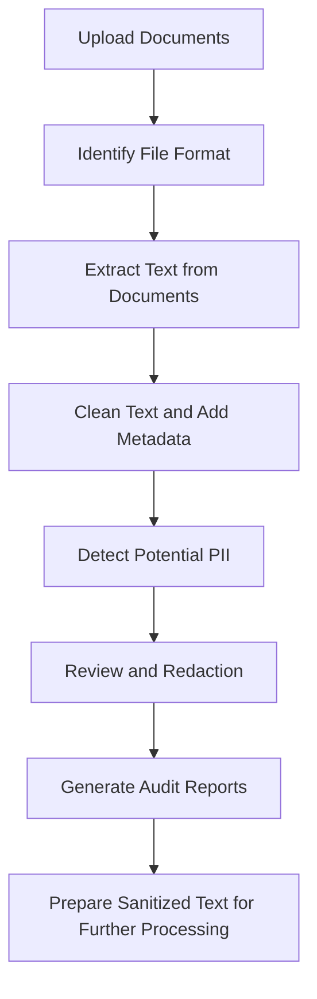

#  Enterprise PII Sanitization & Data Governance Pipeline
### Cadence Financial Group | Case Study 2: Text Analysis & PII Detection

A Python-based pipeline designed to identify and protect sensitive information in enterprise documents before their text is passed to downstream LLMs.

---

## 1. Project Overview

Cadence Financial Group uses AI-based tools to analyze internal documents and extract useful information. However, these documents may contain sensitive data, such as employee names, email addresses, phone numbers, and employee or account IDs.

Sharing this information with external AI services can create privacy and data security risks.

Our project aims to address this problem by building a pipeline that extracts text from different document formats, identifies potential Personally Identifiable Information (PII), and prepares the content for sanitization before further processing.

The main goal is to make document analysis safer while keeping the results traceable for review and auditing.

## 2. How the Pipeline Works

The pipeline follows a series of steps, from document extraction to PII detection and reporting.



### Main steps

1. **Document extraction:** Read text from Word documents, PowerPoint presentations, and PDFs. OCR can be used for scanned PDFs when supported by the extraction component.
2. **Text processing:** Organize the extracted text and retain details such as the source file, page or slide number, and segment ID.
3. **PII detection:** Use regular expressions to identify structured information and spaCy's Named Entity Recognition (NER) to help identify person names.
4. **Redaction and review:** Use the detected information to support redaction, with uncertain results flagged for review where that functionality is implemented.
5. **Reporting:** Store findings in structured formats such as CSV and JSON so they can be reviewed and traced back to their source.

## 3. Repository Structure

The repository is organized into separate folders and modules to make the project easier to understand, test, and maintain.

```text
cadence-pii-sanitization-pipeline/
│
├── 01_Demo/
│   ├── main.py
│   └── Cadence_PII_Detection.ipynb
│
├── 02_Presentation/
│   └── Cadence_PII_Detection.pptx
│
├── 03_Diagrams/
│   ├── functional_blueprint.png
│   └── technical_architecture.png
│
├── 04_Results/
│   ├── findings.csv
│   ├── findings.json
│   ├── pipeline_summary.json
│   ├── qa_log.csv
│   └── sanitized_outputs/
│
├── extractor.py
├── pii_detector.py
└── README.md
```

*Note: The structure above represents the planned project layout. Keep only files and features that are actually present in the repository.*

## 4. Technologies Used

| Technology | Purpose |
|---|---|
| Python | Main programming language |
| `python-docx` | Extracting text from Word documents |
| `python-pptx` | Extracting text from PowerPoint slides |
| PyMuPDF (`fitz`) | Reading text from PDFs |
| Tesseract OCR | Extracting text from scanned pages |
| spaCy | Identifying potential person names |
| Regular expressions (`re`) | Detecting emails, phone numbers, IP addresses, and supported ID patterns |
| pandas | Organizing and exporting results |

## 5. Running the Project

### Option A: Run the terminal demo

If the integration script is available in the repository, run:

```bash
python 01_Demo/main.py
```

If supported by the script, you can also specify an input directory and preview count:

```bash
python 01_Demo/main.py --preview 5 --input-dir ./data
```

The exact commands and output locations depend on the implementation in `main.py`.

### Option B: Use the notebook

1. Open `01_Demo/Cadence_PII_Detection.ipynb` in Jupyter or Google Colab.
2. Run the cells in order.
3. Review the detection results and any available before-and-after comparisons.
4. Inspect the generated reports and sanitized outputs, if those features are implemented.

## 6. Testing and Evaluation

Testing is an important part of checking whether the detector identifies sensitive information and avoids flagging ordinary text unnecessarily.

The current PII detector was tested using 15 predefined test cases:

- **10 positive tests:** Examples containing PII patterns that the detector is expected to identify.
- **5 negative tests:** Ordinary text that should not be flagged.

All 15 test cases passed.

The detector was also run against 3,299 extracted text segments and reported 673 potential PII findings. These included person names, email addresses, account or employee IDs, and phone numbers.

These findings are candidates for review, not necessarily 673 confirmed cases of PII. In particular, name detection can produce false positives, so further validation is needed before relying on the results for production use.

Precision and recall should be reported only when they have been calculated using a labelled evaluation dataset.

## 7. Security and Privacy

The pipeline is designed to process document content within the local Python environment, helping reduce the need to send sensitive text to external services.

For a secure deployment, the team should also verify that every component—including extraction, OCR, logging, and downstream processing—runs locally and does not transmit document contents externally.

Access to raw documents and generated findings should be restricted because the output reports may themselves contain sensitive information.

## 8. Current Limitations and Future Improvements

Some types of PII are easier to detect than others. Regular expressions work well for predictable formats, while person-name detection depends on the surrounding text and may produce false positives or miss some names.

Potential improvements include:

- Expanding the test dataset with more real-world examples.
- Measuring precision and recall against manually labelled results.
- Improving name and ID detection.
- Adding review flags for uncertain findings.
- Validating that redaction preserves text offsets and does not leave sensitive information behind.
- Testing the complete pipeline before using it with external AI systems.

## 9. Conclusion

This project brings document extraction, PII detection, and reporting together in a single workflow. By identifying potential sensitive information and making the results traceable, it provides a foundation for safer document processing.

The next step is to validate the detection results and verify the complete sanitization workflow so the pipeline can be used more reliably with enterprise documents.
